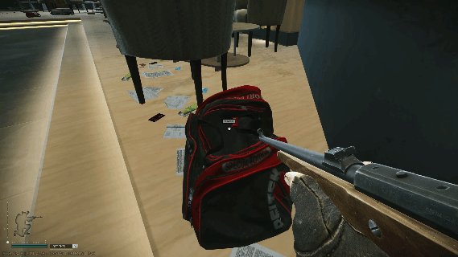

# LookyLoot

Client-side mod for **SPT 4.1.6** (BepInEx 5 / HarmonyX). Free-look around the in-raid
inventory or container/corpse loot screen.



## Build / install

The repo's `.mise.toml` activates a .NET SDK. References come from your local SPT install;
no game libraries are redistributed.

```bash
mise install
dotnet build -c Release
# Optional: also copy the plugin to the local game install
dotnet build -c Release -p:InstallPlugin=true
```

Default game path: `~/Games/SPT-4.1`. Override with `-p:SptRoot=/path/to/SPT`.
Or copy `bin/Release/netstandard2.1/LookyLoot.dll` into
`SPT/BepInEx/plugins/LookyLoot/` manually. A plain build never installs anything.

## Config — `BepInEx/config/com.ngharo.lookyloot.cfg`

| Section | Key | Default | Purpose |
|---|---|---|---|
| General | `Enabled` | `true` | Live master switch |
| General | `CursorDeltaScale` | `0.015` | **Advanced:** raw axis units per cursor pixel, before bound sensitivity |
| Peek | `FullEffectAngle` | `45` | Head angle in degrees reaching full presentation; **not** an activation threshold |
| Peek | `Scale` | `0.35` | Inventory scale at full effect |
| Peek | `Opacity` | `0.65` | Inventory-only opacity at full effect |
| Peek | `WorldBlur` | `0.25` | Remaining inventory blur at full effect; 1 preserves vanilla, 0 removes it |
| Peek | `Parallax` | `1.5` | Inverse head-relative panel movement; 0 disables displacement |

Advanced entries appear when advanced settings are shown in BepInEx Configuration
Manager; they remain editable in the config file. Upgrades preserve saved values:
reset the individual entries (or remove them with the game closed) to adopt new defaults.
